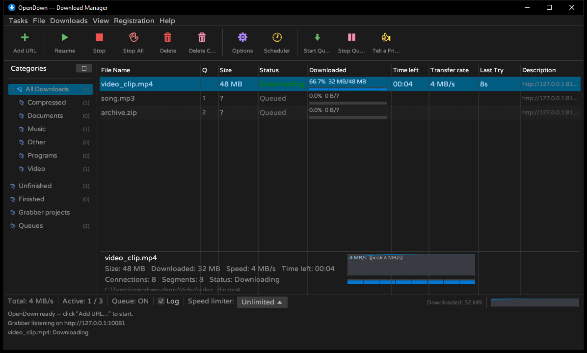

# OpenDown

**Open-source IDM-style download manager for Windows, written in Rust.**

Multi-connection segmented downloads with crash-safe resume · egui GUI · CLI · browser auto-grabber (Chrome/Edge extension)



## Install

- **Installer (recommended)** — `opendown-setup-*.exe` from [Releases](../../releases/latest).
  Per-user install (no admin), Start Menu shortcut, and it ships the browser extension
  files (one manual "Load unpacked" step — see [Browser extension](#browser-extension)).
- **Portable** — `opendown-*-windows-x64.exe` from [Releases](../../releases/latest);
  run it directly, no install.
- **From source** — see [Build from source](#build-from-source).

Requirements: Windows 10/11 (x64). The binaries are unsigned — SmartScreen may warn on
first run (More info → Run anyway).

## Features

**Engine**
- Segmented downloads (up to 32 connections) with automatic single-stream fallback
- Crash-safe resume: `.part` + `.tgmeta` sidecar files — pausing or even killing the app
  mid-download loses nothing
- Per-segment retries, redirect following, speed limiter, custom User-Agent / Referer / Cookie

**GUI (egui — dark theme by default, classic light theme option)**
- IDM-style layout: menu bar, 11-button icon toolbar, full-height *Categories* tree,
  full-width status bar with speed limiter and live speed graph
- 9-column table — File Name, Q, Size, Status, Downloaded, Time left, Transfer rate,
  Last Try, Description — with per-connection segment bars, sortable headers, full-row
  selection, right-click context menu and resizable columns
- Detail panel for the selected download, Add-URL dialog, options, log pane, clipboard URL monitor
- System tray: close/minimize hides to the tray and downloads keep running, with an
  optional "start with Windows" toggle
- IDM-style popup windows for downloads — always-on-top and centered on screen:
  a **confirmation window** per grabbed file (review/edit name and folder first),
  a **live progress window** for downloads in flight, and a **"Download complete"
  window** — drag its file icon straight into Explorer or any folder to save a copy
- Original assets only: icons drawn in code, UI font **Varela Round** (SIL OFL)

**CLI**
- `opendown --cli <URL> [-o DIR] [-f NAME] [-n CONNS] [--limit KB] [--resume]`

**Browser grabber**
- Local endpoint (`127.0.0.1:10081`) plus a Chrome/Edge extension (Manifest V3)
- Sniffs media/file requests, floating grab panel on pages, per-tab list in the popup,
  right-click "Download with OpenDown", IDM-style download takeover
- Grabbed downloads carry referer + cookies; by default a confirmation window appears
  first (turn off *"Show a confirmation window for grabbed downloads"* in Options to
  auto-start instead)

## Browser extension

Browsers block extensions installed outside their official stores (2024+ security
policies) — there is no silent install path. The installer ships the extension files;
enable it once, manually:

1. Open `edge://extensions` (or `chrome://extensions`) and turn on **Developer mode**.
2. Click **Load unpacked** and select the extension's `unpacked` folder
   (`%LOCALAPPDATA%\Programs\OpenDown\extension\unpacked` when installed; in this
   repo it is `extension/`). `extension\browser-extension-setup.cmd` opens both for you.

The extension stays enabled while Developer mode is on; the startup "developer mode
extensions" warning is harmless. `.crx` is provided for Chromium forks that still allow
off-store installs; Firefox is not supported.

The extension talks to the app over localhost only:

- `GET /ping` → `{"ok":true,"app":"opendown"}`
- `POST /add` — JSON: `url`, `referer`, `filename`, `cookie`

Port (default `10081`) and grabber on/off live in the app's Options window; the popup can
change the port and toggle download takeover.

## Build from source

Any Windows Rust toolchain works:

```
cargo build --release
```

`build.bat` targets the portable [w64devkit](https://github.com/skeeto/w64devkit) +
rustup (GNU host) setup used during development — no MSVC needed. `run_gui.bat` and
`run_cli.bat` launch the built binaries (`target\release\opendown.exe`).

Release artifacts (app, `.crx`, `.zip`, NSIS installer) are produced by
`scripts/make_release.sh` into `dist/`; the installer script is `installer/opendown.nsi`.

## Data

Config and task list live in `%APPDATA%\OpenDown\` (`config.json`, `tasks.json`).

## Testing

- Engine: segmented download, no-Range fallback, pause/resume, kill-and-resume — sha256 verified
- HTTPS (native-tls) — sha256 verified
- Grabber end-to-end: extension payload → task created → downloaded file matches source (sha256)
- Installer: silent install → files + registry verified → app smoke test → clean uninstall
- Tray: `scripts/tray_test.sh` + `scripts/tray_sim.ps1` — hidden start, grabs still processed while hidden, simulated tray Show/Exit
- Popup windows (E2E with real synthetic clicks): `scripts/popup_test.sh` — tray-start → grab → confirmation window → click Download → file downloaded (sha256) → "Download complete" window; plus the auto-start path when confirmation is off

## License

MIT — see [LICENSE](LICENSE).

Bundled font: **Varela Round** (SIL Open Font License 1.1 — [assets/OFL.txt](assets/OFL.txt)).

OpenDown is an original project: no code or artwork from Tonec's "Internet Download
Manager" (IDM) is included — only the general UI style is inspired by it. Not affiliated
with or endorsed by Tonec Inc.
